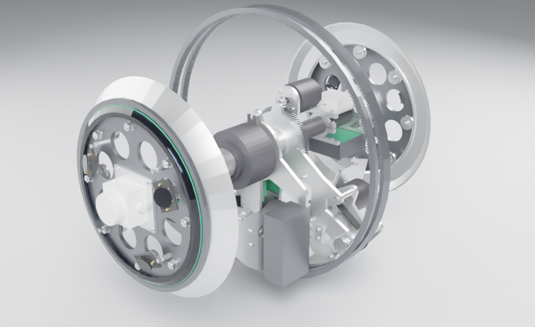
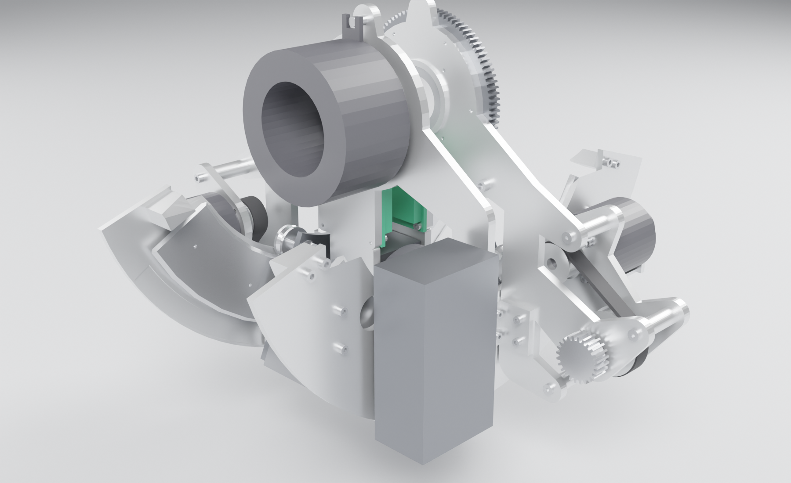
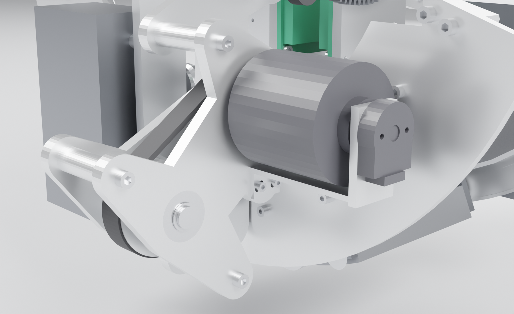
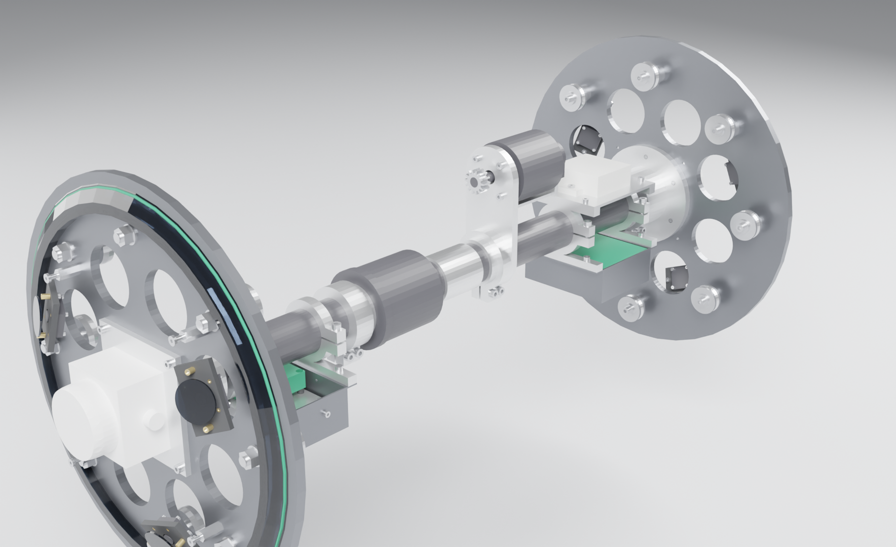
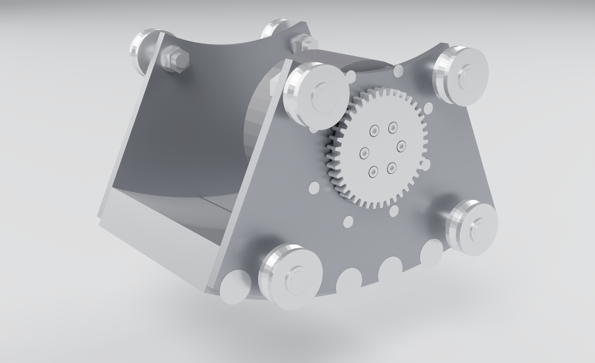
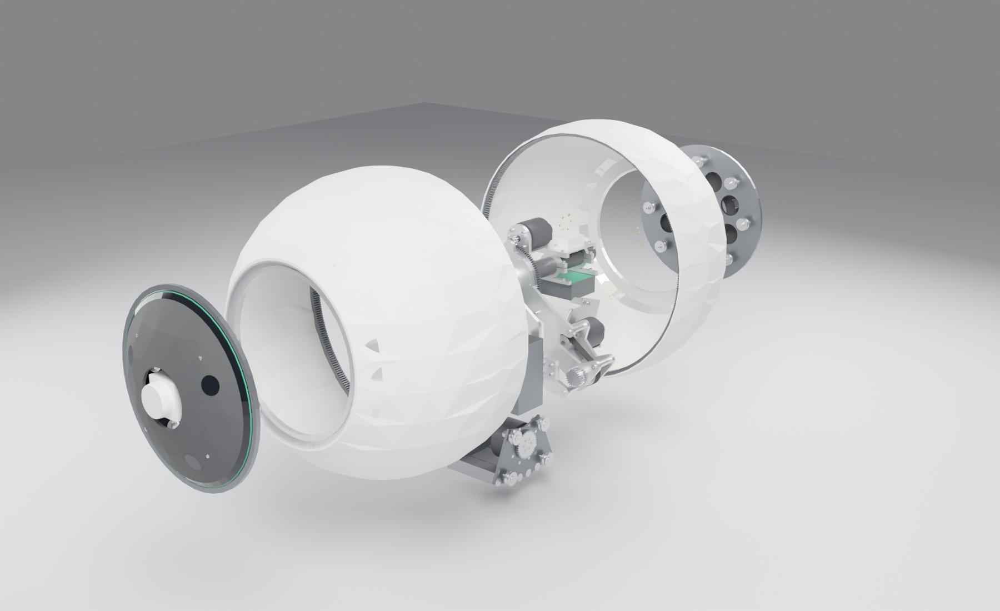

# 11 Build: GYRA Mk2.1 as it will be made

The concept CAD (`cad/gyra2_cad.py`, docs 05) shows what the robot is; the **build CAD** (`cad/build/`) shows how
to make it. Every part that is machined, printed, cast, cut or bought is a solid with its material and process.
So is every screw, nut, washer, insert, PEM nut, dowel, circlip and E-clip, with its standard, length and
tightening torque. The holes they need are cut from the joints, not drawn by hand. The bought parts use their
datasheet dimensions, and the hardware has McMaster-Carr part numbers. The model is then checked by machine:

- static interference;
- thread engagement;
- floating parts;
- a continuous proof that nothing collides anywhere in the range of motion;
- an assembly-path check that every subassembly can go in along the path it really takes.

| | |
|---|---|
| parts | **659**: 157 made, 91 bought, 411 fasteners |
| BOM | 46 custom drawings, 28 bought part numbers, 421 fasteners in 46 kinds (`cad/build/out/bom.md`) |
| mass | **52.7 kg** (yoke 12.6, bob 12.1, spine 11.5, tyre halves 8.2 + 8.3); CoM 79 mm below the centre |
| static interference | **0** hits |
| joints (thread engagement, screw length, head clearance) | **0** problems |
| floating parts | **0** |
| continuous motion clearance | **0** collisions, **0** pairs closer than 0.3 mm: yoke pitch over its ±103.3° stop range × bob lean ±41.5°, tyre spin; 578 pair-intervals, 12,762 exact distance evaluations |
| assembly paths | **12 of 12** moves clear, every part placed by a step |
| engineering checks | **42 of 42** pass (`cad/build/out/calcs.md`) |
| control on the build masses | 0% falls over 16 scenarios × 3 episodes (concept: 0%); speed error 0.34 m/s (concept 0.29); 15 Wh/km |


Renders of the build model (`render/render_build.py`):

| | |
|---|---|
|  |  |
|  |  |
|  |  |

## 1. Files and commands

| | |
|---|---|
| `cad/build/spec.py` | every dimension and every bought part (part number, datasheet source, verified flag) |
| `cad/build/lib.py` | geometry kernel, ISO fastener tables (4762, 7380, 10642, 4032/7040, 7089, 273 clearances, tap drills, counterbores, McMaster 94180A inserts), engagement rules, torques, `Joint` → holes + fasteners |
| `cad/build/tyre.py` `pod.py` `spine.py` `yoke.py` `bob.py` `cots.py` | the five bodies and the bought-part models |
| `cad/build/assemble.py` | builds everything, applies the joints, writes `out/parts.json`, `joints.json`, `connections.json`, `mass_properties.json` |
| `cad/build/checks.py` + `sweep.py` | static interference, joints, floating parts, continuous motion clearance → `out/checks.json` |
| `cad/build/assembly.py` | assembly-path check → `out/assembly_check.json` |
| `cad/build/calcs.py` | 36 hand calculations from the simulated loads → `out/calcs.md` |
| `cad/build/bom.py` | BOM with McMaster numbers → `out/bom.md`, `out/bom.csv` |
| `cad/build/guide.py` | per-step fastener / torque table (section 5) → `out/assembly_steps.md` |
| `cad/build/export.py` | assembly STEP, one STEP per drawing, STL (printed parts), DXF (plates), A3 PDF sheets with hole tables → `out/release/` |
| `rl/actuator_loads.py`, `rl/yoke_range.py`, `rl/build_mass_check.py` | actuator duty, used yoke angle, and the control re-checked on the build masses |

```bash
python cad/build/assemble.py                  # ~80 s
python -u cad/build/checks.py                 # static + joints + floating + continuous motion (4 processes)
python -u cad/build/assembly.py               # assembly paths
python cad/build/calcs.py && python cad/build/bom.py && python cad/build/guide.py
python cad/build/export.py                    # release package
python rl/build_mass_check.py --episodes 3    # deployed control on the build masses
```

## 2. What changed from the concept, and why

| | concept (Mk2.1) | build | why |
|---|---|---|---|
| Seam | wire-race slewing ring between the halves | **no seam bearing**: each half rides on its own pod (left: 8 DualVee W2 on a 90° V-track = axial + radial location; right: 8 INA LR201 crowned rollers on a cylindrical land = radial only) | a 600 mm slewing ring is heavy and costly, and two located bearings fight thermal growth between the CFRP axle and the GFRP tyre |
| Ring gear | separate ring bolted in | one-piece 7075, co-bonded in the drum mould | its OD (278–282) cannot pass the 276.5 mm seam opening afterwards |
| Battery | 13S4P 936 Wh on the bob | **12S2P Molicel P50B, 432 Wh**, two 6S2P modules on the yoke outside the arc plates | 13S exceeds the ODrive S1's 50.5 V limit; 936 Wh does not fit; 432 Wh gives about 23 km at the simulated 16 Wh/km |
| Compute | on the pendulum | Jetson on the spine (left bay) | the cameras and LiDARs are on the spine; the slip ring then carries only power, CAN and e-stop |
| Lean drive | | CubeMars AK70-10 + 40T m1.5 pinion in an internal rack R195 (6.5:1) | sim duty: p99 44 N·m at the bob, ≤ 3.5 rad/s |
| Level drive | | D6374 + 14T/96T m1.5 (6.86:1) | sim duty: 15 N·m (saturated), ≤ 10.4 rad/s |
| Drive | 24:1 | D6374 → HTD 5M P20/P32 → 24T pinion → 360T ring | same 24:1 |
| Motor encoders | (not modelled) | **AMT212B-V-OD absolute encoder on every D6374** | the S1s sit on heat spreaders away from the motors, so their on-board encoder cannot see the motor |
| Axle | 40 × 34 | **40 × 30 HM CFRP** (E ≥ 150 GPa) | gear-mesh stiffness: 0.19 mm sag into the mesh at 3 g, within the 0.35 mm backlash |
| Pendulum travel | "360° free" | **±102.5° yoke-to-spine, PU-bumpered stops** | see below |
| GNSS | antenna only | ANN-MB1 antenna + ZED-F9P receiver board (left bay, under the Jetson) | the ANN-MB1 is an active antenna, not a receiver |
| Cameras | | 6 × Waveshare OV9281 (A), square to the shell behind PC windows; 4 through a USB hub in the right bay | the Jetson carrier has 4 USB-A ports |
| Mass | 45.1 kg | **52.7 kg** | real hardware (fasteners, brackets, bearings, cases); the deployed control still works on it (section 8) |

**Why the pendulum no longer turns 360°.** The concept claimed the spine had nothing in the pendulum's swept
volume. With the real level drive this is false. A D6374 (Ø63 × 90) sits on the pendulum axis's side at 82.5 mm,
meshing with the 96T gear on the left hanger. At full lean (41.5°) the bob's inner wheels come within 81 mm of
the axle line, so with that lean they reach the level motor at 104.4° of yoke-to-spine angle. The arc-plate tips
reach its rear boss at 108.2°, whatever the lean. The deployed control uses up to **99.4°**, measured over all 16
robustness scenarios by `rl/yoke_range.py`; the worst is climbing a 12° incline.

Two PU-sleeved strikers on the left hanger meet the flanks of the level-bracket arm at ±102.5°. That leaves
3.1° over the control's maximum and 1.1° to the first collision, after up to 0.8° of bumper compression. The
continuous motion check proves the whole ±103.3° × ±41.5° range clear.

To win more travel later, the level drive can become an internal ring gear on the hanger. The motor would then sit
at 61.5 mm from the axle instead of 82.5 mm.

## 3. Bought parts

| qty | part | source / status |
|---|---|---|
| 16 | Bishop-Wisecarver DualVee W2X (size 2, steel, shielded) | Bishop-Wisecarver DualVee catalogue 2025 |
| 8 | hex standoff M4 male-female, 8 mm hex x 18 mm, 18-8 stainless |  |
| 8 | INA LR201-2RSR (crowned outer ring R500) | Schaeffler catalogue data via distributor |
| 6 | Waveshare OV9281 1MP Mono USB Camera (A) | waveshare.com outline drawing |
| 4 | M3 x 6 brass standoff, male-female |  |
| 4 | hex standoff M4 female-female, 7 AF x 12 mm, aluminium or brass |  |
| 4 | nylon spacer 6 x 3.2 x 5 mm |  |
| 4 | nylon spacer 6 x 3.2 x 7.9 mm (cut from 6 x 3.2 tube) |  |
| 4 | 6001-2RSNR (snap ring) (NSK 6001DDU) |  |
| 3 | ODrive D6374-150KV (dual shaft) | ODrive D6374 STEP (odriverobotics.com product page CAD link), measured in cad/build/vendor.py |
| 3 | CUI Devices (Same Sky) AMT212B-V-OD (AMT21 RS485 absolute, ODrive firmware) | Same Sky AMT21 datasheet rev 1.11 (2026-06-23) p.7-8; ODrive docs hardware.html (S1 supports CUI-AMT212B-V-OD) |
| 3 | ODrive S1 (ODS1) on heat spreader ACC-HS04 | docs.odriverobotics.com S1 datasheet + ACC-HS04 listing |
| 2 | Livox Mid-360 | Livox Mid-360 User Manual v1.2 (2023.06), Appendix 'Dimensions' p.19 |
| 2 | Moflon MT05012-0606 (6 x 10 A + 6 x 2 A signal) | Moflon MT050 drawing + catalogue page |
| 2 | 6908-2RS (NSK 6908DDU) | NSK catalogue E1102m |
| 2 | PU 90A tube 20 x 12, cut 10 long, bonded on (Loctite 406) |  |
| 2 | Gates P32-5M-15AL (MPB, rebore 12H7 + DIN 6885 4x4 keyway + M5 set screw) | Gates data (MROSupply) |
| 2 | Gates P20-5M-15AL (MPB, rebore 10H7 + 3 mm keyway + M4 set screw) | Gates data (MROSupply) |
| 2 | Gates PowerGrip HTD 285-5M-15 (57 T) | Gates HTD 5M list (260, 270, 285, 295, 310 ...) |
| 2 | 12 x Molicel INR-21700-P50B (6S2P), spot-welded 0.15 mm nickel, PC cell holders |  |
| 1 | NVIDIA Jetson Orin NX 16 GB on Seeed reComputer J401 carrier | Seeed wiki; **verify before machining:** carrier hole pattern from Seeed STEP before machining the bay plate |
| 1 | Waveshare 12694 USB HUB HAT (4 x USB 2.0, 65 x 30 mm, d3.0 holes) | waveshare.com/usb-hub-hat.htm; **verify before machining:** left-pod cameras L0-L2 + a USB-GbE adapter (ASIX AX88179 class) for the right Mid-360; cameras R0-R2 go straight to the J401's other USB-A ports; hole pattern assumed 58 x 23 (Pi Zero) - check the Waveshare drawing |
| 1 | RECOM RPA60-4812SFW (18-75 V in, 12 V 60 W, 2 x 1 in brick) | RECOM RPA60 datasheet; **verify before machining:** baseplate M3 thread positions (2 used here) from the RECOM drawing before drilling the tray wall |
| 1 | MicroStrain 3DM-CV7-AHRS | MicroStrain product page; **verify before machining:** hole positions from the MicroStrain drawing before machining |
| 1 | u-blox ANN-MB1-00 (L1/L5) | u-blox ANN-MB1 datasheet R04 + distributors |
| 1 | SparkFun GPS-RTK2 Board - ZED-F9P (GPS-15136) | sparkfun.com GPS-15136 (43.5 x 43.2 mm); **verify before machining:** under the GNSS plate, components up (<= 6.9 mm), in the gap above the axle; I2C (Qwiic) to the J401 40-pin header (I2C1, pins 3/5), SMA to the ANN-MB1 cable; hole positions from SparkFun's board file |
| 1 | BMS 12S 40 A + MIDI fuse + XT90-S + relay (wired subassembly) |  |
| 1 | CubeMars AK70-10 (KV100, 48 V) | CubeMars brochure 2023 p.07 drawing |


Fasteners, PEM nuts, inserts, dowels, keys, circlips: `cad/build/out/bom.md`. Each line has the standard, size,
quantity, torque and McMaster number, with the source of each number in `cad/build/mcmaster.json`.

## 4. Making the custom parts

The release package (`python cad/build/export.py`, then `cad/build/out/release/`) contains:

- `gyra_mk21_build.step`: the full assembly with every part named;
- `parts/<drawing>.step`: one per drawing, the geometry master;
- `dxf/<plate>.dxf`: plate profiles with all holes, for waterjet or laser;
- `stl/`: the printed parts;
- `drawings/GYRA_Mk21_drawing_set.pdf`: an A3 sheet per drawing. Each sheet has 3 views + iso, the material,
  process and finish, the mass, the overall size, and the hole table that the joints machined into the part
  (tapped / clearance / insert / PEM, position and axis).

| process | parts |
|---|---|
| waterjet + CNC (6061-T6 plate) | hangers (8), arc plates (6), carriage plates (6), outer plates (8), pod plates (8), lidar risers (5), GNSS plate (3, 5052) |
| CNC turned / milled | hub cartridges, hub spacer, level bracket, slip sleeve, bay clamps, pod hubs, rims, wheel studs (303), bob studs (303), cassette and track spacers, pitch strikers, encoder brackets |
| gears | ring gears 7075 m1.5 z360 (gear shaping or wire EDM, hard anodise); level gear 7075 z96; lean rack 7075 (wire EDM); pinion shafts 24T, lean pinion 40T, level pinion 14T (42CrMo4 QT, hob; drive pinions gas-nitrided) |
| tracks | AISI 1045, V edges induction-hardened HRC 53 to the DualVee track specification |
| sheet metal (5052-H32, laser + bend + PEM) | bay trays, mezzanine, battery cases, power box |
| MJF PA12 | pod shields, camera holders (heat-set inserts) |
| composites | drums: E-glass / epoxy 3 mm, vacuum infusion in a 2-piece female mould, ring gear placed in the mould; axle: roll-wrapped HM CFRP 40 × 30 |
| cast | treads: 70A PU cast in place in a closed mould |
| tungsten | 3 × W-Ni-Fe (ASTM B777 class 3) sectors, M8 tapped 16 deep in both end faces |
| PCB | LED ring PCB (24 × WS2812B-2020, 12→5 V buck) |

## 5. Assembly sequence

The order below is the one `assembly.py` verifies. Each move is simulated along its real path against everything
already installed. Torques and threadlocker for every fastener are in the table at the end of this section, which
is generated from the joints.

**T. Tyre halves (bench).**
1. Infuse each drum with its ring gear located in the mould on the crown-plane spigot (co-bonded). Add a DP490
   fillet at the gear's back edges.
2. Pass the rim ring in through the seam opening and bond it into the drum's outer edge with DP490 (30 mm band).
   Its OD clears the drum interior everywhere; verified along the whole path.
3. Cast the tread in place.

**B. Bob (bench).**
1. Tungsten blocks between the carriage plates: 12 × M8 FHCS class 10.9.
2. AK70-10 on the front carriage (8 × M3 FHCS), lean pinion on its output (6 × M3, counterbored).
3. V-wheel studs: the outer studs thread into the tungsten; the inner studs are eccentric, with washer + nyloc. Fit
   the wheels and DIN 6799 E-clips.

**Y. Yoke (bench).**
1. Left hanger: hub cartridge (spigot 66 h7, bearing 6908 + DIN 472), level gear, drive ODrive S1 on its heat
   spreader, pitch-stop strikers with PU sleeves.
2. Right hanger: hub cartridge, drive S1, slip-ring drive pin (pressed).
3. Arc plates: tracks on spacers, lean rack on spacers.
4. Frame: arc brackets join the arc plates to the hangers. Fit the power box (BMS, fuse, anti-spark, relay).
5. **2a. Run the bob onto the tracks** with the lean stops off. It rotates in about x from beyond the track end
   (verified from 120° down to 0). Set the inner eccentric studs for zero play. Fit the lean stops.
6. Drive cassettes, one per side:
   - pinion shaft with its 6001 bearings;
   - P32 pulley (key + set screw), belt, P20 on the D6374;
   - motor screws through the ±2 mm slots;
   - tension the belt (Gates 5M 15 mm: set with a sonic tension meter to the Design Flex value);
   - fit the encoder bracket (its foot slots move with the motor) and the AMT212;
   - mount the cassette on its 3 spacers.
7. Battery modules A and B on their spacers (PEM nuts in the case ends).

**S. Onto the axle.**
1. Hub spacer between the bearings. The yoke + bob unit slides onto the axle from +y.
2. Level drive from +y: bracket clamp on the axle with its land against the left inner race, pinion in mesh with
   the level gear, motor, encoder.
3. Slip ring from −y: sleeve clamp, rotor, housing engaging the yoke's drive pin.
4. Bays slide on from the axle ends:
   - left: Jetson on 25 mm standoffs, ZED-F9P on spacers underneath, GNSS plate and antenna on the clamp tabs;
   - right: level S1, mezzanine with the USB hub, DC-DC, IMU.

**5. Tyre halves.** Each slides on seam-first, held 15 mm off-centre toward its pinion so the ring gear clears the
drive cassette, then moves radially into mesh. The path is verified in 5 mm steps.

**6. Pods.** Each pod slides on from its axle end, then its hub clamp closes on the axle.
- Left: the V-wheels are turned out on their 3.5 mm eccentric studs during the slide, then set against the V-track.
- Right: the rollers clear the land by 0.3 mm and are preloaded on their 1 mm eccentrics.
- Then fit the LiDARs, cameras, light ring and shields.

**Checks before first power:**
- the yoke turns by hand to both pitch stops;
- the bob leans by hand to both lean stops;
- each tyre turns freely;
- backlash at both drive meshes is 0.15–0.45 mm (feeler or dial);
- belt tension.

**Fasteners by step** (generated from the joints by `cad/build/guide.py`):

| step | fastener | into | torque | threadlocker | qty |
|---|---|---|---|---|---|
| B1  bob: tungsten blocks between the carriage plates | ISO 10642 M8 x 14 10.9 | tapped | 32.0 N m | Loctite 243 | 12 |
| B2  bob: AK70-10 on the front carriage, lean pinion on its output | ISO 10642 M3 x 16 A2-70 | tapped | 1.0 N m | Loctite 243 | 8 |
|  | ISO 4762 M3 x 16 A2-70 | tapped | 1.0 N m | Loctite 243 | 6 |
| Y1  left hanger: hub cartridge, level gear, drive controller, pitch-stop strikers | ISO 4762 M4 x 10 A2-70 | tapped | 2.3 N m | Loctite 243 | 4 |
|  | ISO 4762 M4 x 12 A2-70 | tapped | 2.3 N m | Loctite 243 | 4 |
|  | ISO 4762 M4 x 16 A2-70 | tapped | 2.3 N m | Loctite 243 | 6 |
|  | ISO 4762 M6 x 14 A2-70 | tapped | 7.8 N m | Loctite 243 | 2 |
| Y2  right hanger: hub cartridge, drive controller | ISO 4762 M4 x 10 A2-70 | tapped | 2.3 N m | Loctite 243 | 4 |
|  | ISO 4762 M4 x 12 A2-70 | tapped | 2.3 N m | Loctite 243 | 4 |
| Y3  arc plates: tracks on spacers, lean rack | ISO 4762 M4 x 14 A2-70 | tapped | 2.3 N m | Loctite 243 | 10 |
|  | ISO 4762 M4 x 25 A2-70 | tapped | 2.3 N m | Loctite 243 | 6 |
|  | ISO 4762 M5 x 14 A2-70 | tapped | 4.5 N m | Loctite 243 | 8 |
| Y4  frame: arc brackets join arc plates to hangers, power box | ISO 4762 M4 x 12 A2-70 | tapped | 2.3 N m | Loctite 243 | 16 |
|  | ISO 7380-1 M4 x 12 A2-70 | PEM nut | 2.3 N m | Loctite 243 | 8 |
| Y5  front drive cassette: motor, pulleys, belt on the outer plate; encoder bracket + AMT212 (after belt tension) | ISO 4762 M2.5 x 6 A2-70 | tapped | 0.5 N m | Loctite 243 | 2 |
|  | ISO 4762 M3 x 8 A2-70 | tapped | 1.0 N m | Loctite 243 | 2 |
|  | ISO 4762 M4 x 12 A2-70 | tapped | 2.3 N m | Loctite 243 | 4 |
| Y6  front cassette onto the hanger (spacers), belt tension by motor slots | ISO 4762 M5 x 16 A2-70 | tapped | 4.5 N m | Loctite 243 | 3 |
|  | ISO 7380-1 M5 x 16 A2-70 | tapped | 4.5 N m | Loctite 243 | 3 |
| Y7  rear drive cassette: motor, pulleys, belt | ISO 4762 M2.5 x 6 A2-70 | tapped | 0.5 N m | Loctite 243 | 2 |
|  | ISO 4762 M3 x 8 A2-70 | tapped | 1.0 N m | Loctite 243 | 2 |
|  | ISO 4762 M4 x 12 A2-70 | tapped | 2.3 N m | Loctite 243 | 4 |
| Y8  rear cassette onto the hanger | ISO 4762 M5 x 16 A2-70 | tapped | 4.5 N m | Loctite 243 | 3 |
|  | ISO 7380-1 M5 x 16 A2-70 | tapped | 4.5 N m | Loctite 243 | 3 |
| Y9  battery module A (left of the arc plates) | ISO 4762 M5 x 22 A2-70 | PEM nut | 4.5 N m | Loctite 243 | 4 |
| Y10 battery module B | ISO 4762 M5 x 22 A2-70 | PEM nut | 4.5 N m | Loctite 243 | 4 |
| S1  level motor onto the level bracket; encoder bracket + AMT212 | ISO 4762 M2.5 x 6 A2-70 | tapped | 0.5 N m | Loctite 243 | 2 |
|  | ISO 4762 M3 x 8 A2-70 | tapped | 1.0 N m | Loctite 243 | 2 |
|  | ISO 4762 M4 x 12 A2-70 | tapped | 2.3 N m | Loctite 243 | 4 |
| S2  level bracket clamp on the axle (pinion in mesh with the level gear) | ISO 4762 M5 x 20 A2-70 | tapped | 4.5 N m | Loctite 243 | 2 |
| S3  slip-ring sleeve clamp on the axle | ISO 4762 M5 x 20 A2-70 | tapped | 4.5 N m | Loctite 243 | 2 |
| S4  left bay: clamps on the axle, tray | ISO 4762 M4 x 10 A2-70 | PEM nut | 2.3 N m | Loctite 243 | 4 |
|  | ISO 4762 M5 x 20 A2-70 | tapped | 4.5 N m | Loctite 243 | 2 |
| S5  right bay electronics: level controller, DC-DC, IMU | ISO 4762 M2 x 4 A2-70 | tapped | 0.25 N m | Loctite 243 | 2 |
|  | ISO 4762 M3 x 4 A2-70 | tapped | 1.0 N m | Loctite 243 | 2 |
|  | ISO 4762 M4 x 10 A2-70 | tapped | 2.3 N m | Loctite 243 | 4 |
| S5b right bay: mezzanine on the controller standoffs, USB hub | ISO 4762 M3 x 10 A2-70 | PEM nut | 1.0 N m | Loctite 243 | 4 |
|  | ISO 4762 M4 x 6 A2-70 | tapped | 2.3 N m | Loctite 243 | 4 |
| S6  right bay: clamps on the axle, tray | ISO 4762 M4 x 10 A2-70 | PEM nut | 2.3 N m | Loctite 243 | 4 |
|  | ISO 4762 M5 x 20 A2-70 | tapped | 4.5 N m | Loctite 243 | 2 |
| S7  GNSS antenna on its plate, ZED-F9P receiver under it | ISO 4762 M3 x 12 A2-70 | PEM nut | 1.0 N m | Loctite 243 | 4 |
|  | ISO 7380-1 M4 x 10 A2-70 | PEM nut | 2.3 N m | Loctite 243 | 2 |
| S8  GNSS plate onto the left bay clamps | ISO 4762 M4 x 10 A2-70 | tapped | 2.3 N m | Loctite 243 | 4 |
| P1  left pod: V-wheels on eccentric studs | ISO 4762 M5 x 8 A2-70 | tapped | 4.5 N m | Loctite 243 | 8 |
| P2  left pod: plate onto the hub | ISO 10642 M5 x 16 A2-70 | tapped | 4.5 N m | Loctite 243 | 6 |
| P3  left pod: Mid-360 on its riser | ISO 4762 M3 x 6 A2-70 | tapped | 1.0 N m | Loctite 243 | 4 |
| P4  left pod: riser onto the plate (dowelled) | ISO 4762 M4 x 12 A2-70 | tapped | 2.3 N m | Loctite 243 | 4 |
| P5  left pod: cameras into holders, holders into the shield | ISO 4762 M2 x 10 A2-70 | heat-set insert | hand tight (0.5 N m) | - | 12 |
|  | ISO 4762 M3 x 10 A2-70 | heat-set insert | hand tight (0.5 N m) | - | 6 |
| P6  left pod: shield onto the standoffs | ISO 7380-1 M4 x 12 A2-70 | tapped | 2.3 N m | Loctite 243 | 4 |
| P7  left pod hub clamp on the axle end | ISO 4762 M5 x 20 A2-70 | tapped | 4.5 N m | Loctite 243 | 2 |
| P8  right pod: crowned rollers on studs | ISO 4762 M5 x 8 A2-70 | tapped | 4.5 N m | Loctite 243 | 8 |
| P9  right pod: plate onto the hub | ISO 10642 M5 x 16 A2-70 | tapped | 4.5 N m | Loctite 243 | 6 |
| P10 right pod: Mid-360 on its riser | ISO 4762 M3 x 6 A2-70 | tapped | 1.0 N m | Loctite 243 | 4 |
| P11 right pod: riser onto the plate | ISO 4762 M4 x 12 A2-70 | tapped | 2.3 N m | Loctite 243 | 4 |
| P12 right pod: cameras, holders | ISO 4762 M2 x 10 A2-70 | heat-set insert | hand tight (0.5 N m) | - | 12 |
|  | ISO 4762 M3 x 10 A2-70 | heat-set insert | hand tight (0.5 N m) | - | 6 |
| P13 right pod: shield | ISO 7380-1 M4 x 12 A2-70 | tapped | 2.3 N m | Loctite 243 | 4 |
| P14 right pod hub clamp on the axle end | ISO 4762 M5 x 20 A2-70 | tapped | 4.5 N m | Loctite 243 | 2 |
| studs | ISO 7040 M8 nyloc on wheel studs | - | 12.0 N m | (nyloc) | 20 |

296 threaded fasteners in 35 steps. Torques: ISO 898-1 / ISO 3506 class, ~70 % of proof load, lightly oiled; into aluminium the tapped length is >= 1.5 d (6061) / 1.25 d (7075), checked by checks.py.


## 6. Wiring

| from | to | conductor | through |
|---|---|---|---|
| battery A (6S2P) + battery B (6S2P) in series | power box: XT90-S anti-spark → 40 A MIDI fuse → 12S BMS → 48 V bus | 10 AWG silicone | yoke |
| 48 V bus | drive S1 front, drive S1 rear | 12 AWG | yoke |
| 48 V bus + CAN | AK70-10 (XT30 + CAN JST) | 14 AWG + twisted pair | yoke → bob: service loop clipped along the arc plate (±42° travel) |
| 48 V bus, GND | slip ring 2 × 10 A rings each (paralleled) | 12 AWG | yoke → spine |
| e-stop loop (2 signal rings) | power-box relay coil (cuts the drive S1s and the AK70-10) | 22 AWG | spine ↔ yoke |
| CAN H/L + CAN GND (3 signal rings) | one bus: Jetson (J401 CAN) ↔ level S1 ↔ slip ring ↔ drive S1 F ↔ drive S1 R ↔ AK70-10 ↔ BMS; 120 Ω at the Jetson and at the AK70-10 | 22 AWG twisted pair | spine ↔ yoke |
| S1 (each) | D6374 phases (4 mm bullets); AMT212 RS485 + 5 V (S1 ISO port) | motor leads; 26 AWG shielded 6-wire | yoke / spine |
| spine 48 V | level S1; RECOM RPA60 48 → 12 V | 14 AWG | right bay |
| 12 V | Jetson J401 (12–19 V in), 2 × Mid-360 (9–27 V), LED rings (5 V buck on the LED PCB) | 16–20 AWG | axle slots at y ±170 / ±296 |
| Jetson USB-A 1 | USB hub (right bay) → cameras L0, L1, L2 + USB-GbE adapter (ASIX AX88179 class) → right Mid-360 | USB 2.0 | axle slots |
| Jetson USB-A 2, 3, 4 | cameras R0, R1, R2 | USB 2.0 (MJPEG) | axle slot −y |
| Jetson GbE | left Mid-360 (Livox M12 cable) | Cat5e | axle slot +y |
| Jetson UART1 (40-pin 8/10, 3.3 V) | IMU 3DM-CV7 UART (Samtec FTSH 10-pin pigtail, 3.3–5 V supply from 5 V) | 4-wire | right bay |
| Jetson I2C1 (40-pin 3/5) | ZED-F9P (Qwiic); ANN-MB1 on the SMA | Qwiic cable | left bay |

## 7. Commissioning

1. **ODrive S1 × 3 on CAN.** Node IDs: drive F = 1, drive R = 2, level = 3.
   - DC bus over-voltage trip 50.4 V; regen current limit set to what the BMS accepts.
2. **Encoders.** Set `encoder` to RS485 / AMT21 (event-driven mode for the -OD firmware). Then run motor
   calibration and encoder offset calibration per motor, with the belt off for the drive motors.
3. **Lean.** AK70-10 in MIT mode. Zero it at the mechanical centre (bob straight down). Software limits ±40°.
   The hard stops are at about ±42°.
4. **Level.** Zero it with the spine level on a flat floor. Software limit on the yoke-to-spine angle: ±100°. The
   hard stops are at ±102.5°.
5. **IMU.** Its x axis is along the robot's forward axis. Run the misalignment calibration on a level surface.
6. **GNSS.** Configure the ZED-F9P (u-center) for 115200 baud UBX-NAV-PVT at 10 Hz on UART2.

## 8. Verification

**What each check proves.**

| check | method | result |
|---|---|---|
| static interference | every pair of parts in different subsystems plus every pair involving a fastener, exact boolean intersection (> 0.05 mm³ fails); allowed: a screw/insert/PEM in the member it threads into, declared thread pairs, gear meshes | 0 |
| joints | engagement ≥ 1.0 d (steel), 1.25 d (7075, brass), 1.5 d (6061), vendor thread depth for bought parts; no screw longer than its hole; head and shank touch only their own members | 0 |
| floating parts | every part touches, or is bonded / threaded / meshed to, a part of its own body | 0 |
| continuous motion | for every pair that moves relatively, the motion range is bisected; at each box centre the exact minimum distance is computed and compared with the largest distance any point can travel inside the box (radius × half-angle), so the whole range is proven, not sampled. Running clearance required: 0.3 mm | 0 collisions, 0 near-misses |
| assembly paths | each subassembly (found from the joint graph) is moved along its real path in ≤ 5 mm / 2° steps against everything already installed | 12/12 clear |

What the continuous check found that the earlier sampled check (30° steps) had missed, all fixed:

- the hub-cartridge screw heads swept through the level-bracket clamp;
- the bob's inner wheel studs swept through the power box and its hanger land;
- the bob reached the level motor and the arc-plate tips reached its rear boss beyond ±100°. Hence the ±102.5° pitch stops and the arc-plate trim;
- the lean-stop blocks swept through the bay trays;
- the lean pinion passed the rack spacers at 0.02 mm, and the bob's wheel studs passed the arc plates at 0.24 mm.

**Pendulum range actually used** (`rl/yoke_range.py`, build masses): max 99.5° yoke-to-spine (p99 87.8°), lean max 40.1°, fastest outward yoke rate above 90° 2.23 rad/s.

**Control on the build hardware** (`rl/build_mass_check.py`): the deployed policy (rl/runs/loco31), trained on the concept masses, run on the build CAD's masses and inertias:

| | concept masses | build masses |
|---|---|---|
| falls | 0% | 0% |
| speed tracking error | 0.294 m/s | 0.338 m/s |
| sensor-platform tilt (rms) | 0.208 | 0.204 |
| energy | 14 Wh/km | 15 Wh/km |

**Engineering checks** (loads from the simulator, `cad/build/calcs.py`):

| group | check | value | allowable | ok | note |
|---|---|---|---|---|---|
| drive gear | pinion root bending, p99 | 16.9 MPa | 300.0 | yes | 42CrMo4 QT + nitrided, allowable bending ~300 MPa |
| drive gear | ring root bending, p99 | 11.8 MPa | 150.0 | yes | 7075-T6 fatigue ~150 MPa |
| drive gear | contact stress, p99 | 160 MPa | 250.0 | yes | hard-anodised 7075 vs steel; p99 kept under 250 MPa for wear life; peak is rare |
| drive gear | pinion root bending, peak (motor limit 82 N m) | 40.1 MPa | 300.0 | yes | 42CrMo4 QT + nitrided, allowable bending ~300 MPa |
| drive gear | ring root bending, peak (motor limit 82 N m) | 28.1 MPa | 150.0 | yes | 7075-T6 fatigue ~150 MPa |
| drive gear | contact stress, peak (motor limit 82 N m) | 247 MPa | 400.0 | yes | hard-anodised 7075 vs steel; p99 kept under 250 MPa for wear life; peak is rare |
| axle | bending stress, 1 g | 8.73 MPa | 400.0 | yes | HM CFRP, allowable well above (UD 0 deg strength > 1 GPa) |
| axle | mid-span sag, 1 g | 0.093 mm |  | yes |  |
| drive gear | pinion pushed into the ring by axle sag, 1 g | 0.062 mm | 0.35 | yes | design backlash: centre distance +0.20 mm -> 0.15-0.45 mm operating |
| axle | bending stress, bump 3 g | 26.2 MPa | 400.0 | yes | HM CFRP, allowable well above (UD 0 deg strength > 1 GPa) |
| axle | mid-span sag, bump 3 g | 0.28 mm |  | yes |  |
| drive gear | pinion pushed into the ring by axle sag, bump 3 g | 0.187 mm | 0.35 | yes | design backlash: centre distance +0.20 mm -> 0.15-0.45 mm operating |
| belt | tight-side tension at motor peak torque | 239 N |  |  | verify against Gates HTD 5M 15 mm allowable working tension (Design Flex) - 285-5M-15 at 20T; tooth-in-mesh 6.3 |
| bearings | 6001 hanger bearing A: radial load p99 | 235 N | 2370 | yes | L10 at p95 speed 1297 rpm: 174,255 h |
| bearings | 6001 outer-plate bearing B: radial load p99 | 21.7 N | 2370 | yes | L10 at p95 speed 1297 rpm: 221,836,200 h |
| bearings | 6908 hub bearing, 3 g bump (per bearing) | 363 N | 10000 | yes |  |
| support wheels | DualVee W2 radial per wheel, 1 g | 103 N | 2650 | yes |  |
| support wheels | DualVee W2 axial per wheel (crown moment), 1 g | 105 N | 625 | yes | bump case against 2 x working axial (short-duration); size 3 (W3, 1701 N axial) is the drop-in upgrade if field data demands |
| support wheels | LR201 roller radial per roller (floating side), 1 g | 103 N | 2850 | yes |  |
| support wheels | DualVee W2 radial per wheel, bump 3 g | 310 N | 2650 | yes |  |
| support wheels | DualVee W2 axial per wheel (crown moment), bump 3 g | 314 N | 1250 | yes | bump case against 2 x working axial (short-duration); size 3 (W3, 1701 N axial) is the drop-in upgrade if field data demands |
| support wheels | LR201 roller radial per roller (floating side), bump 3 g | 310 N | 2850 | yes |  |
| lean drive | AK70-10 output torque, rms | 2.8 N m | 8.3 | yes |  |
| lean drive | AK70-10 output torque, p99 | 7.12 N m | 24.8 | yes |  |
| lean drive | AK70-10 output torque, peak | 19.4 N m | 24.8 | yes |  |
| lean drive | pinion root bending at peak | 153 MPa | 300.0 | yes |  |
| lean drive | rack root bending at peak | 132 MPa | 150.0 | yes |  |
| lean drive | AK70-10 speed at max lean rate | 215 rpm | 310 | yes |  |
| level drive | D6374 torque at the level limit (15 N m) | 2.3 N m | 3.8 | yes |  |
| level drive | D6374 rms current | 18.8 A | 40.0 | yes | ODrive S1 40 A with heat spreader |
| drive | D6374 rms current (p rms tyre torque) | 9.76 A | 40.0 | yes |  |
| fixings | tungsten block (3.5 kg) on 4 x M8 10.9: shear per bolt at 5 g | 1.18 MPa | 200.0 | yes | bolts clamp: friction alone carries it at proper preload |
| fixings | battery module (1.3 kg) on 4 x M5: shear per bolt at 5 g | 1.12 MPa | 200.0 | yes | bolts clamp: friction alone carries it at proper preload |
| pitch stop | yoke-to-spine angle used by the deployed control (max, 16 scenarios) | 99.5 deg | 101.5 | yes | stop contact at 102.5 deg; first collision without the stop at 104.4 deg |
| pitch stop | inertia about the axle: pendulum / spine / reduced (what the bumper sees) | 0.106 kg m2 |  |  | pendulum 1.00, spine 0.119: on contact the spine is carried along |
| pitch stop | relative arrival rate the bumper absorbs within its 1.3 mm (0.8 deg) travel | 3.09 rad/s |  | yes | capacity 0.51 J; the control's fastest outward yoke rate above 90 deg is 2.23 rad/s |
| pitch stop | striker bending at full bumper travel (d12 C45 steel) | 115 MPa | 300.0 | yes | 780 N at 25 mm; arm flank bearing 16 MPa (6061) |
| pitch stop | level-bracket clamp slip torque vs stop torque at full bumper travel | 74.1 N m | 113.1 | yes | 2 x M5 split clamp on the 40 mm CFRP axle, friction 0.2 |
| pitch stop | fault: both drive motors at their torque limit from 60 deg (relative energy at the stop) | 9.71 J |  |  | far beyond any end stop: guarded by the drive S1s' CAN watchdog (idle on lost heartbeat), the +-100 deg software limit and the e-stop relay |
| battery | usable range at the simulated mix | 23 km |  | yes | 432 Wh, 85 % usable, 16 Wh/km |
| battery | pack current at p99 mechanical power (+60 W electronics) | 19.6 A | 120.0 | yes | 12S2P P50B: 2 x 60 A continuous; the two drive ODrives are current-limited to 60 A phase each |
| slip ring | spine power through 2 paralleled 10 A rings | 4.63 A | 20.0 | yes | Jetson 25 W + 2 LiDAR 13 W + cameras 6 W + level motor ~150 W peak |


## 9. Open items: verify before ordering

1. **Hole patterns to take from the vendor files before machining.** Each part is marked `verified=False` in
   `spec.py`:
   - Seeed J401 carrier (bay standoffs);
   - MicroStrain 3DM-CV7 (tray end wall);
   - RECOM RPA60 baseplate threads;
   - SparkFun ZED-F9P board;
   - Waveshare USB hub (58 × 23 assumed).
2. **Belt.** The tight-side tension at peak motor torque is 239 N. Confirm it against the Gates HTD 5M 15 mm allowable in
   Design Flex, and set the installation tension from it. The pulleys' 16 mm flange gap is modelled from the
   Gates drawing.
3. **BMS.** Choose a 12S 40 A BMS that fits 74 × 44 × 15 mm on edge in the power box.
4. **McMaster numbers marked "series - pick size".** `bom.md` names the series; pick the exact size on
   mcmaster.com: DIN 472-62, M8 FHCS 10.9, the dowel 8 × 20, set screws, and the M2.5 / M3 / M5 / M6 socket head
   lengths not individually verified.
5. **AMT212 shaft engagement.** The D6374 rear shaft enters the encoder by 9.5 mm. Confirm with the AMT kit's
   Tool A spacing, and shim the bridge if needed.
6. **Pitch stops.**
   - 3° separate the control's maximum (99.5°) from the stop (102.5°), and about 1.9° separate the stop from the
     first collision.
   - A drive-torque runaway brings about 10 J to the stop, far beyond its 0.5 J. So configure and test the S1
     CAN-heartbeat watchdog, the ±100° software limit and the e-stop relay before the first drive.
   - Moving the level drive to an internal ring on the hanger would win about 10° more travel.
7. **Tooling.** The drum moulds (2-piece female, with the ring-gear spigot) and the tread mould are the largest
   one-off cost and lead time.
8. **Tracks.** Get the 1045 V-edge induction hardening (HRC 53) quoted to the DualVee track drawing.

